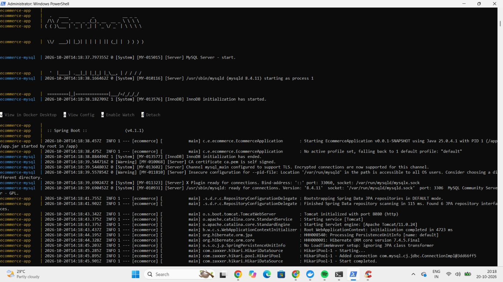
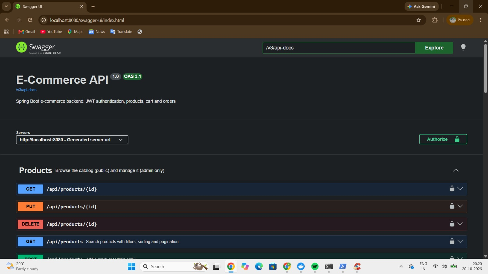
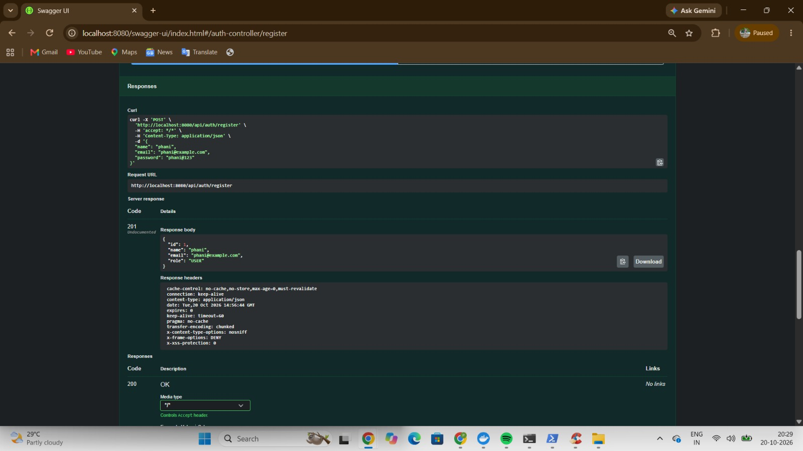
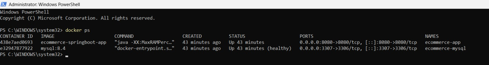

# E-Commerce REST API

A backend for an online store, built with **Spring Boot**. It covers user registration and login with JWT, a product catalog with search and pagination, a shopping cart, and transactional order placement, with role-based access for customers and admins.

## Features

- **Authentication:** register and login, passwords hashed with BCrypt, stateless JWT tokens
- **Role-based access:** `USER` and `ADMIN` roles; only admins manage products, categories and orders
- **Products and categories:** CRUD, with search by keyword, category and price range, sorting, and pagination
- **Shopping cart:** one cart per user, add/update/remove items, stock checks, running total
- **Orders:** place an order from the cart, order history, cancel, and admin status updates (PLACED, SHIPPED, DELIVERED, CANCELLED)
- **Data safety:** price snapshot saved with each order, stock restored on cancellation, ownership checks so users only see their own orders
- **Validation and error handling:** request validation with clear messages, one global exception handler
- **API documentation:** Swagger UI (OpenAPI)
- **Tests:** 29 unit tests with JUnit and Mockito

## Tech Stack

| Layer | Technology |
|---|---|
| Language | Java 25 |
| Framework | Spring Boot 4.1 (Web MVC, Data JPA, Security, Validation) |
| Database | MySQL 8 with Hibernate |
| Auth | Spring Security, JWT (jjwt), BCrypt |
| Docs | springdoc-openapi (Swagger UI) |
| Testing | JUnit, Mockito, AssertJ |
| Build | Maven (wrapper included) |

## Architecture

```
Client -> Controller -> Service -> Repository -> MySQL
              |           |
             DTOs     business rules, @Transactional
```

A JWT filter runs before the controllers, reads the token, and tells Spring Security who is calling and with which role.

## Database

Tables: `users`, `categories`, `products`, `carts`, `cart_items`, `orders`, `order_items`

- Category 1 : N Product
- User 1 : 1 Cart, Cart 1 : N CartItem
- User 1 : N Order, Order 1 : N OrderItem
- `order_items` stores the product name and price at purchase time, so old orders keep their original prices

## API Overview

Full interactive documentation: `http://localhost:8080/swagger-ui.html`

| Method | Endpoint | Access |
|---|---|---|
| POST | `/api/auth/register` | Public |
| POST | `/api/auth/login` | Public |
| GET | `/api/products` (keyword, categoryId, minPrice, maxPrice, page, size, sortBy, direction) | Public |
| GET | `/api/products/{id}`, `/api/products/category/{categoryId}` | Public |
| POST / PUT / DELETE | `/api/products`, `/api/products/{id}` | Admin |
| GET | `/api/categories`, `/api/categories/{id}` | Public |
| POST | `/api/categories` | Admin |
| GET | `/api/cart` | User |
| POST | `/api/cart/items` | User |
| PUT / DELETE | `/api/cart/items/{itemId}` | User |
| POST | `/api/orders` | User |
| GET | `/api/orders/my` | User |
| GET | `/api/orders/{id}` | Owner or Admin |
| PUT | `/api/orders/{id}/cancel` | Owner |
| GET | `/api/admin/orders` | Admin |
| PUT | `/api/admin/orders/{id}/status` | Admin |


## Screenshots

### Application started


### Swagger UI


### Successful order response


### Docker containers running


## Project Structure


## Getting Started

### Prerequisites
- JDK 25
- MySQL 8 running locally
- (Maven is not needed; the wrapper is included)

### Run locally

```bash
git clone https://github.com/phanibandham/Ecommerce-springboot.git
cd Ecommerce-springboot
```

Set two environment variables. Secrets are never stored in the repository.

```bash
# Windows (cmd)
set DB_PASSWORD=your_mysql_password
set JWT_SECRET=a_random_string_of_at_least_32_characters

# macOS / Linux
export DB_PASSWORD=your_mysql_password
export JWT_SECRET=a_random_string_of_at_least_32_characters
```

Start the app (the database `ecommerce_db` and its tables are created automatically):

```bash
mvnw spring-boot:run
```

Open Swagger UI at `http://localhost:8080/swagger-ui.html`.

### Create an admin user
Registration always creates a `USER`. To make an admin on purpose, register normally and then run:

```sql
UPDATE users SET role = 'ADMIN' WHERE email = 'your@email.com';
```

Log in again to get a token that carries the new role.

### Use the API in Swagger
1. `POST /api/auth/login` and copy the `token` from the response.
2. Click **Authorize**, paste the token, and confirm.

## Running Tests

```bash
mvnw test
```

The unit tests cover token handling, registration and login, product search rules, and the order lifecycle (stock reduction, cancellation, ownership).

## Project Structure

```
src/main/java/com/example/ecommerce
 |- config        security rules, OpenAPI setup
 |- controller    REST endpoints
 |- dto           request and response objects
 |- entity        JPA entities
 |- enums         Role, OrderStatus
 |- exception     custom exceptions, global handler
 |- repository    Spring Data JPA repositories
 |- security      JWT utility and filter, current-user helper
 |- service       business logic
src/test/java     unit tests
```

## Design Decisions

- **Stateless JWT:** the server stores no sessions; the signed token carries the email and role.
- **BCrypt hashing:** passwords are never stored or logged in plain text.
- **DTOs instead of entities in the API:** clients cannot set fields like `id` or `role`.
- **Transactional checkout:** stock reduction, order creation and cart clearing succeed or fail together.
- **Ownership checks in the service layer:** order queries use both the order id and the user id.
- **Whitelisted sorting and capped page size:** protects the database from bad input.

## Known Limitations and Next Steps

- Two buyers purchasing the last item at the same moment could oversell it; optimistic locking (`@Version`) would fix this
- Prices use `double`; `BigDecimal` is the better choice for money
- No payment gateway yet (Razorpay test mode is a natural next step)
- Integration tests with a real or in-memory database are not added yet
- No frontend; the API is tested with Swagger and Postman

## Author

**Phani Kumar Bandham** — <your LinkedIn link> — <your email>
